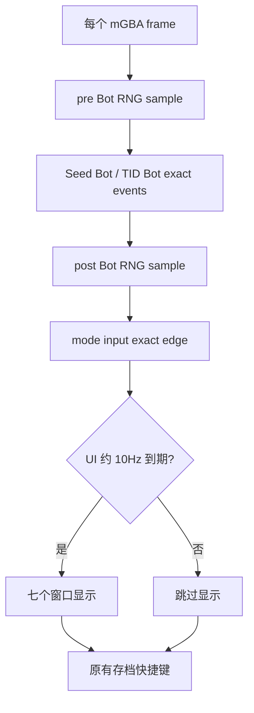

# FRLG P1：精确帧通道与自适应显示调度器

[[../README]] · [[02-gen3-mgba-frlg]] · [[04-benchmark-protocol]] · [[05-p0-p4-roadmap]]

代码位置：[`Gen 3/mGBA/FRLG_RNG_mGBA.lua`](https://github.com/969981/PokeLua/blob/develop/Gen%203/mGBA/FRLG_RNG_mGBA.lua)；修改仅发生在 `develop`，`main` 原版保持不变。

## 实施内容
- 将 `updateBuffers()` 拆为精确帧通道与 `renderBuffersP1()`。
- 精确帧通道**每个 mGBA frame 回调都执行**：`getRngInfo`、`updateInitialSeedBotLogic`、`updateTIDBotLogic`、`pollInfoModeInput`、`getSaveStateInput`。
- 为保持原版 `updatePokemonInfoBuffer()` 在 Bot 之后调用 `showRngInfo` 的语义，保留 Bot 执行前后两次 RNG 采样（主要修复 Bot 重载存档后的同帧状态更新）；而非原版五个窗口分别采样。
- 原始 `initialSeedBotLoop()` / `TIDBotLoop()` 内的按键第 1/35/40 帧、Watchpoint、保存及载入暂存状态的调用不改；仅把其 `print/clear` 替换为最近观测值。
- `getInfoInput` 的控制器 R+Left/Right 模式切换迁移至逐帧 `pollInfoModeInput`，避免因 UI 降频遗漏短按键。
- `renderBuffersP1()` 按自适应 `p1RenderInterval` 调度七个 UI 区块；第一次绘制立即执行。
- 自适应调度使用 `os.time()` 的粗粒度真实秒测量实际 Lua frame 回调率，初始间隔 6 帧，目标约 10Hz；1×–16× 时稳定后以回调计数而非 `emu:currentFrame()` 计时，故 Bot 即时存档回退不会造成 UI 计时倒退。
- 用户的数字存档键仍保留原版逐帧处理。长按重复 I/O、复杂预测 `while`、表创建与 PK3 解密属于后续 P2/P3，不在此次混改。

## 实现语义

### 不能误读为“绝对 10Hz”
`os.time()` 分辨率为一秒，所以自适应有启动校准期（在直接从 16× 启动时第一秒可能刷新较多）；加速倍率突然变化时也存在短暂延迟。不是硬实时限频，也不是经过真实时间戳验证的准确 10Hz。下一步可以在确认 mGBA 提供高精度墙钟后再引入更平滑的时钟适配，但必须先用真实 Profiler 验证必要性。

## 离线 Mock 对账
测试：`tests/p1/frlg_mock.lua` + `tests/p1/compare.py`；运行 `python tests/p1/compare.py --lua texlua`（需要 checkout 到本机并有 Lua 5.3+）。测试将原版和优化版目标改为相同值后，对比：
1. 1× / 16× 空闲回调与累计 RNG Advances；
2. TID Bot 连续失败重试后成功，保存／恢复状态与输入帧事件序列；
3. Initial Seed Bot 失败重试后成功，第 1／35／40 帧按键与 Watchpoint；
4. UI print/clear 与内存读取次数作为 Mock **相对指标**（禁止称真实 FPS）。

本次开发会话本地通过同类模拟测试，但正式 GitHub `main` 原版和 `develop` 文件仍需按上述命令复测；真实 mGBA、ROM 和 16× 的结果全部是 **RUNTIME_NOT_OBSERVED**。

## 下一道关口
先使用同一 ROM/存档实测 P1 的 1×/4×/8×/16× 性能和 RNG/两个 Bot 轨迹；过关后进入 P2：把 `getEncounterMissingSteps` 预测循环从主 UI 任务中隔离成预算化计算，并对 PK3 解码和外部读取建立失效缓存。
